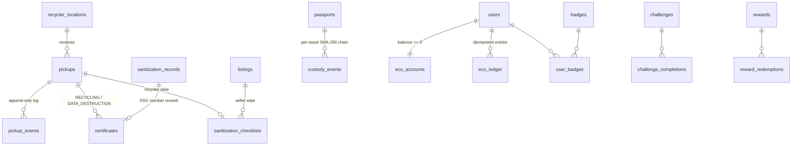

# E-CYCLE ER diagram

Generated from the same domain model that produces `V1__schema.sql`, so it cannot drift from the database.
Render with any Mermaid viewer (GitHub, VS Code Mermaid preview, https://mermaid.live).

Relationship notes (`ON DELETE`):
- `listing_images`, `wishlists.listing_id`, `passport_events`, `password_reset_tokens`, `user_roles` cascade from their parent.
- Business records (`listings`, `orders`, `payments`, `disputes`, `bids`, ...) never cascade-delete: listings are *withdrawn*, not deleted, so history survives.
- Append-only tables (triggers in `V2__integrity_triggers.sql`): `dispute_evidence`, `dispute_messages`, `dispute_resolutions`, `audit_logs`, `bids`, `product_lifecycle`, `passport_events`, `hazard_inspections`, `environmental_impact`.
- Partial unique indexes: one *active* order per listing, one *active* dispute per order, unique provider payment id.

```mermaid
erDiagram
  roles {
    bigint id PK
    varchar name UK
  }
  users {
    bigint id PK
    varchar email UK
    varchar password_hash
    varchar full_name
    varchar phone
    AccountStatus status
    int failed_logins
    timestamptz locked_until
    timestamptz created_at
  }
  seller_profiles {
    bigint id PK
    bigint user_id FK
    varchar business_name
    varchar address
    varchar city
    VerificationStatus verification_status
    timestamptz verified_at
    numeric trust_score
  }
  buyer_profiles {
    bigint id PK
    bigint user_id FK
    varchar organization
    BuyerType buyer_type
    varchar city
    boolean verified
    int recovery_capability
    int environmental_rating
  }
  product_categories {
    bigint id PK
    varchar name UK
    varchar description
    int repairability_base
    int component_recovery_base
    int life_months
    numeric default_weight_kg
    boolean dismantlable
    boolean active
  }
  listings {
    bigint id PK
    bigint seller_id FK
    bigint category_id FK
    varchar name
    varchar brand
    varchar model
    int age_months
    ItemCondition physical_condition
    FunctionalStatus functional_status
    int quantity
    numeric expected_price
    text description
    varchar pickup_city
    varchar pickup_address
    numeric weight_kg
    Pathway pathway
    ListingStatus status
    varchar rejection_reason
    numeric score_function
    numeric score_condition
    numeric score_repair
    numeric score_reuse
    numeric score_component
    numeric score_life
    numeric circular_score
    Pathway recommended_pathway
    text score_explanation
    HazardLevel hazard_level
    boolean shipping_blocked
    varchar specialist_required
    boolean requires_sanitization
    boolean sanitization_verified
    boolean auction_enabled
    int auction_hours
    numeric auction_min_price
    timestamptz created_at
    timestamptz updated_at
  }
  listing_images {
    bigint id PK
    bigint listing_id FK
    varchar file_path
    varchar original_name
    varchar content_type
    varchar sha256
    timestamptz created_at
  }
  offers {
    bigint id PK
    bigint listing_id FK
    bigint buyer_id FK
    numeric amount
    varchar message
    OfferStatus status
    timestamptz created_at
  }
  orders {
    bigint id PK
    bigint listing_id FK
    bigint buyer_id FK
    bigint seller_id FK
    bigint offer_id FK
    bigint bid_id
    int quantity
    numeric amount
    OrderStatus status
    varchar shipping_address
    varchar cancel_reason
    timestamptz created_at
    timestamptz updated_at
  }
  payments {
    bigint id PK
    bigint order_id FK
    varchar provider
    varchar provider_order_id
    varchar provider_payment_id
    numeric amount
    PaymentStatus status
    varchar receipt_no UK
    timestamptz verified_at
    timestamptz created_at
  }
  shipments {
    bigint id PK
    bigint order_id FK
    varchar carrier
    varchar tracking_no
    ShipmentStatus status
    boolean specialist_handling
    timestamptz updated_at
  }
  refunds {
    bigint id PK
    bigint payment_id FK
    bigint order_id FK
    bigint dispute_id
    numeric amount
    varchar reason
    RefundStatus status
    varchar provider_refund_id
    timestamptz created_at
  }
  disputes {
    bigint id PK
    bigint order_id FK
    bigint raised_by FK
    bigint against_user FK
    bigint resolver_id FK
    DisputeCategory category
    text description
    DisputeStatus status
    DisputePriority priority
    timestamptz created_at
    timestamptz updated_at
    timestamptz resolved_at
  }
  dispute_assignments {
    bigint id PK
    bigint dispute_id FK
    bigint resolver_id FK
    bigint assigned_by FK
    timestamptz created_at
  }
  dispute_evidence {
    bigint id PK
    bigint dispute_id FK
    bigint submitted_by FK
    EvidenceCategory category
    varchar description
    varchar file_path
    varchar original_name
    varchar content_type
    varchar sha256
    timestamptz created_at
  }
  dispute_messages {
    bigint id PK
    bigint dispute_id FK
    bigint sender_id FK
    MessageVisibility visibility
    text body
    timestamptz created_at
  }
  dispute_resolutions {
    bigint id PK
    bigint dispute_id FK
    bigint resolver_id FK
    ResolutionType resolution_type
    numeric refund_amount
    text decision_text
    timestamptz created_at
  }
  reviews {
    bigint id PK
    bigint order_id FK
    bigint reviewer_id FK
    bigint reviewee_id FK
    int rating
    varchar comment
    timestamptz created_at
  }
  wishlists {
    bigint id PK
    bigint user_id FK
    bigint listing_id FK
    timestamptz created_at
  }
  notifications {
    bigint id PK
    bigint user_id FK
    varchar title
    varchar body
    varchar type
    boolean read_flag
    timestamptz created_at
  }
  environmental_factors {
    bigint id PK
    bigint category_id FK
    numeric carbon_reuse_per_kg
    numeric carbon_repair_per_kg
    numeric carbon_refurbish_per_kg
    numeric carbon_recycle_per_kg
    numeric metals_recovery_pct
    varchar source_note
    bigint updated_by FK
    timestamptz updated_at
  }
  environmental_impact {
    bigint id PK
    bigint listing_id FK
    bigint order_id FK
    bigint seller_id FK
    bigint buyer_id FK
    Pathway pathway
    int quantity
    numeric weight_kg
    numeric ewaste_diverted_kg
    numeric carbon_avoided_kg
    numeric materials_recovered_kg
    boolean measured
    text methodology
    text inputs
    bigint recorded_by FK
    timestamptz created_at
  }
  product_lifecycle {
    bigint id PK
    bigint listing_id FK
    LifecycleStage stage
    Pathway pathway
    bigint actor_id FK
    varchar note
    timestamptz created_at
  }
  buyer_requirements {
    bigint id PK
    bigint buyer_id FK
    bigint category_id FK
    numeric max_budget
    varchar city
    ItemCondition min_condition
    varchar intended_use
    varchar required_components
    Pathway preferred_pathway
    boolean active
    timestamptz created_at
  }
  audit_logs {
    bigint id PK
    bigint actor_id
    varchar action
    varchar entity_type
    bigint entity_id
    text detail
    timestamptz created_at
  }
  passports {
    bigint id PK
    varchar passport_code UK
    bigint listing_id FK
    bigint parent_id FK
    varchar component_type
    varchar name
    LifecycleStage stage
    bigint current_owner_id FK
    timestamptz created_at
  }
  passport_events {
    bigint id PK
    bigint passport_id FK
    varchar event_type
    bigint actor_id FK
    varchar detail
    numeric value_amount
    timestamptz created_at
  }
  auctions {
    bigint id PK
    bigint listing_id FK
    timestamptz ends_at
    numeric min_price
    AuctionStatus status
    bigint winning_bid_id
    timestamptz created_at
  }
  bids {
    bigint id PK
    bigint auction_id FK
    bigint bidder_id FK
    numeric price
    Pathway pathway
    int recovery_capability
    int environmental_performance
    varchar recovery_plan
    numeric circular_bid_score
    timestamptz created_at
  }
  score_config {
    bigint id PK
    varchar config_key UK
    numeric config_value
    varchar description
  }
  hazard_rules {
    bigint id PK
    varchar code UK
    varchar description
    int points
    boolean blocks_shipping
    boolean requires_sanitization
    varchar handling
    varchar specialist_type
    boolean enabled
  }
  hazard_inspections {
    bigint id PK
    bigint listing_id FK
    bigint inspector_id FK
    text answers
    int total_points
    HazardLevel level
    text explanation
    text handling
    boolean blocked
    varchar specialist
    timestamptz created_at
  }
  sanitization_records {
    bigint id PK
    bigint listing_id FK
    bigint submitted_by FK
    varchar method
    varchar tool_name
    varchar evidence_ref
    SanitizationStatus status
    bigint verified_by FK
    timestamptz verified_at
    varchar certificate_no UK
    varchar note
    timestamptz created_at
  }
  password_reset_tokens {
    bigint id PK
    bigint user_id FK
    varchar token_hash UK
    timestamptz expires_at
    boolean used
  }
  token_revocations {
    bigint id PK
    varchar jti UK
    timestamptz expires_at
  }
  chat_messages {
    bigint id PK
    bigint listing_id FK
    bigint sender_id FK
    bigint recipient_id FK
    varchar body
    timestamptz created_at
  }
  users ||--o{ user_roles : has
  roles ||--o{ user_roles : grants
  users ||--o{ seller_profiles : "user_id"
  users ||--o{ buyer_profiles : "user_id"
  users ||--o{ listings : "seller_id"
  product_categories ||--o{ listings : "category_id"
  listings ||--o{ listing_images : "listing_id"
  listings ||--o{ offers : "listing_id"
  users ||--o{ offers : "buyer_id"
  listings ||--o{ orders : "listing_id"
  users ||--o{ orders : "buyer_id"
  users ||--o{ orders : "seller_id"
  offers ||--o{ orders : "offer_id"
  orders ||--o{ payments : "order_id"
  orders ||--o{ shipments : "order_id"
  payments ||--o{ refunds : "payment_id"
  orders ||--o{ refunds : "order_id"
  orders ||--o{ disputes : "order_id"
  users ||--o{ disputes : "raised_by"
  users ||--o{ disputes : "against_user"
  users ||--o{ disputes : "resolver_id"
  disputes ||--o{ dispute_assignments : "dispute_id"
  users ||--o{ dispute_assignments : "resolver_id"
  users ||--o{ dispute_assignments : "assigned_by"
  disputes ||--o{ dispute_evidence : "dispute_id"
  users ||--o{ dispute_evidence : "submitted_by"
  disputes ||--o{ dispute_messages : "dispute_id"
  users ||--o{ dispute_messages : "sender_id"
  disputes ||--o{ dispute_resolutions : "dispute_id"
  users ||--o{ dispute_resolutions : "resolver_id"
  orders ||--o{ reviews : "order_id"
  users ||--o{ reviews : "reviewer_id"
  users ||--o{ reviews : "reviewee_id"
  users ||--o{ wishlists : "user_id"
  listings ||--o{ wishlists : "listing_id"
  users ||--o{ notifications : "user_id"
  product_categories ||--o{ environmental_factors : "category_id"
  users ||--o{ environmental_factors : "updated_by"
  listings ||--o{ environmental_impact : "listing_id"
  orders ||--o{ environmental_impact : "order_id"
  users ||--o{ environmental_impact : "seller_id"
  users ||--o{ environmental_impact : "buyer_id"
  users ||--o{ environmental_impact : "recorded_by"
  listings ||--o{ product_lifecycle : "listing_id"
  users ||--o{ product_lifecycle : "actor_id"
  users ||--o{ buyer_requirements : "buyer_id"
  product_categories ||--o{ buyer_requirements : "category_id"
  listings ||--o{ passports : "listing_id"
  passports ||--o{ passports : "parent_id"
  users ||--o{ passports : "current_owner_id"
  passports ||--o{ passport_events : "passport_id"
  users ||--o{ passport_events : "actor_id"
  listings ||--o{ auctions : "listing_id"
  auctions ||--o{ bids : "auction_id"
  users ||--o{ bids : "bidder_id"
  listings ||--o{ hazard_inspections : "listing_id"
  users ||--o{ hazard_inspections : "inspector_id"
  listings ||--o{ sanitization_records : "listing_id"
  users ||--o{ sanitization_records : "submitted_by"
  users ||--o{ sanitization_records : "verified_by"
  users ||--o{ password_reset_tokens : "user_id"
  listings ||--o{ chat_messages : "listing_id"
  users ||--o{ chat_messages : "sender_id"
  users ||--o{ chat_messages : "recipient_id"
```

## V4 additions (eco-assistant upgrade)

MongoDB collections (not in PostgreSQL): `notifications`, `chat_messages`, `assistant_conversations` (incl. LangChain4j memory JSON), `assistant_messages`, `assistant_pending_actions` (TTL index).
